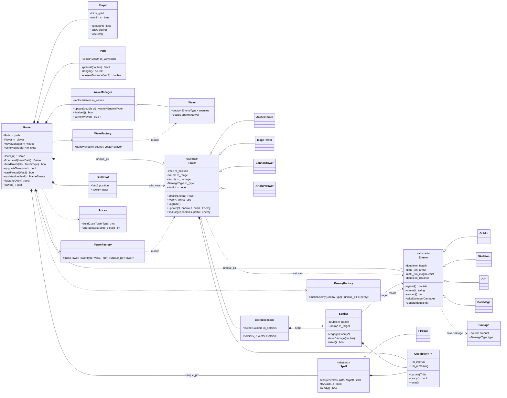
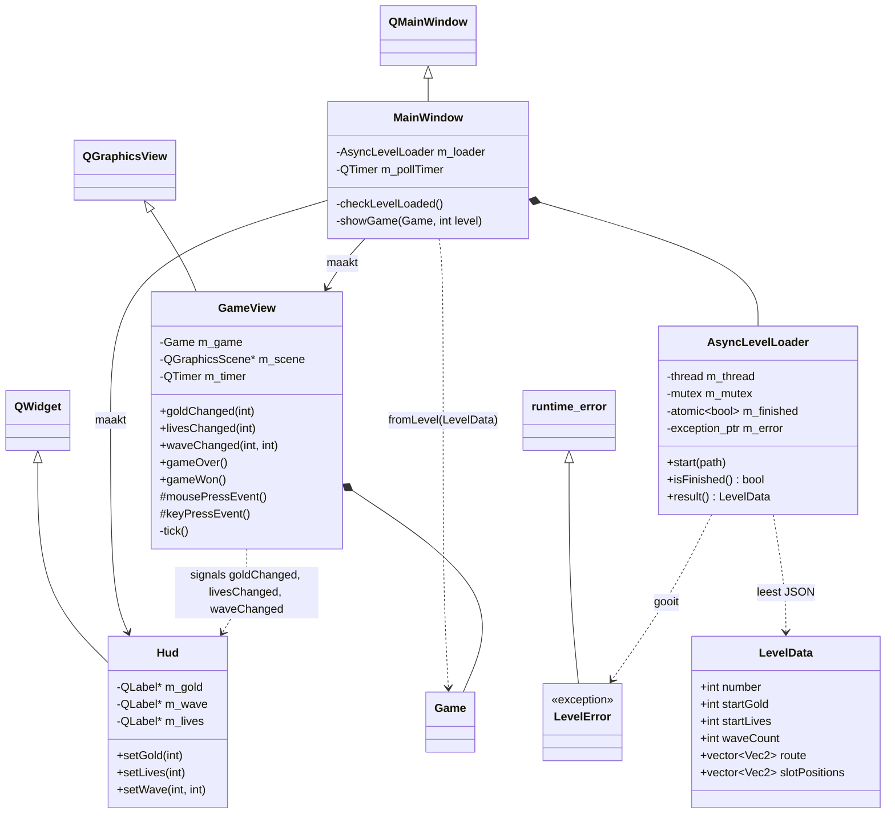

# Kingdom TD

Een tower defense game in C++20 en Qt 6, geïnspireerd op Kingdom Rush. Vijanden lopen over een pad naar je kasteel. Jij bouwt torens op de bouwplekken om ze tegen te houden, en gooit af en toe een vuurbal.

Gemaakt door Matteo Belmans (Matteo757) als eindopdracht C++.

## Inhoud

1. [Spelen](#spelen)
2. [Build-handleiding](#build-handleiding)
3. [UML-diagram](#uml-diagram)
4. [Projectstructuur](#projectstructuur)
5. [Levels aanpassen](#levels-aanpassen)
6. [Tests](#tests)
7. [Bug tickets](#bug-tickets)
8. [Credits en licenties](#credits-en-licenties)

## Spelen

| Actie | Besturing |
|---|---|
| Toren bouwen of upgraden | Linkermuisknop op een bouwplek (het bordje) opent het menu |
| Vuurbal gooien | Rechtermuisknop op het pad (heeft een cooldown) |
| Route tonen of verbergen | Toets `P` (handig om de waypoints te controleren) |

- **Torens:** boogschutter (fysieke schade), mage (magische schade), kanon, artillerie en barracks (soldaten die vijanden tegenhouden). Elke toren kan tot level 3 geüpgraded worden.
- **Vijanden:** goblin, skeleton, orc en dark mage. Ze hebben verschillende health, snelheid, armor en magic resist. Schade wordt dus per type anders verminderd.
- **Doel:** overleef alle waves. Elke vijand die het kasteel bereikt kost een leven. Bij 0 levens is het game over.
- **Levels:** level 1 en level 3 zitten erin. Het spel start in level 1.

## Build-handleiding

Het project is te bouwen op een schone pc met alleen de onderstaande programma's. Alle andere bibliotheken (nlohmann/json) zitten al in de repository onder `third_party/`.

### Wat je nodig hebt

| Programma | Versie |
|---|---|
| C++-compiler met C++20 (GCC 11+, Clang 14+ of MinGW/MSVC met C++20) | |
| CMake | 3.21 of nieuwer |
| Qt | 6.x, met de modules **Widgets** en **Test** |
| Git | om te klonen |

Qt installeer je op elk systeem op een eigen manier:

- **Windows:** download de *Qt Online Installer* van <https://www.qt.io/download-qt-installer>. Kies bij "Qt 6.x" de kit **MinGW 64-bit** en onder "Developer and Designer Tools" ook **CMake** en **MinGW**. Dit is ook de omgeving waarin het project ontwikkeld is (Qt 6.12 met MinGW 64-bit).
- **Ubuntu/Debian:**
  ```bash
  sudo apt update
  sudo apt install build-essential cmake git qt6-base-dev libgl1-mesa-dev
  ```
- **macOS:**
  ```bash
  brew install cmake qt
  ```

### Optie 1: Qt Creator (het makkelijkst)

1. Clone de repository:
   ```bash
   git clone https://github.com/Matteo757/kingdom-td.git
   ```
2. Open Qt Creator, kies *File → Open File or Project* en selecteer `CMakeLists.txt` in de map `kingdom-td`.
3. Kies een Qt 6 kit (bijvoorbeeld *Desktop Qt 6.x MinGW 64-bit*) en klik *Configure Project*.
4. Kies linksonder *Release* of *Debug* en klik op de groene pijl (*Run*). Het project wordt gebouwd en gestart.

### Optie 2: opdrachtregel

```bash
git clone https://github.com/Matteo757/kingdom-td.git
cd kingdom-td

cmake -S . -B build -DCMAKE_BUILD_TYPE=Release
cmake --build build

# programma starten
./build/kingdom-td            # Linux en macOS
build\kingdom-td.exe          # Windows
```

Vindt CMake Qt niet, geef dan de installatiemap van Qt mee. Bijvoorbeeld op Windows:

```bash
cmake -S . -B build -DCMAKE_BUILD_TYPE=Release -DCMAKE_PREFIX_PATH=C:/Qt/6.12.0/mingw_64
```

Op Linux of macOS is dat bijvoorbeeld `-DCMAKE_PREFIX_PATH=$HOME/Qt/6.12.0/gcc_64`.

### Belangrijk om te weten

- **Start het programma vanuit de build-map.** Tijdens het bouwen worden de levelbestanden (`assets/levels/*.json`) automatisch naast het programma gezet, in een map `levels/`. Het spel leest ze bij het starten. De afbeeldingen zitten in het programma zelf (Qt-resources), dus daarvoor hoef je niets te kopiëren.
- **Ontbreekt of is een levelbestand ongeldig?** Dan meldt het spel dat in de console en valt het terug op het ingebouwde level. Het stopt dus niet.
- **Windows buiten Qt Creator:** zorg dat de `bin`-map van Qt en van MinGW in je `PATH` staat, of voer `windeployqt build\kingdom-td.exe` uit om de benodigde DLL's naast het programma te zetten.

### Veelvoorkomende problemen

| Melding | Oplossing |
|---|---|
| `Could not find a package configuration file provided by "Qt6"` | Geef `-DCMAKE_PREFIX_PATH=<pad naar Qt>` mee (zie hierboven). |
| `Qt6Test` niet gevonden (Linux) | Installeer `qt6-base-dev` (bevat Qt Test) in plaats van alleen losse runtime-pakketten. |
| Het programma start maar toont niets / geen levels | Start vanuit de build-map, of kopieer `assets/levels` naar `levels/` naast het programma. |
| Aanpassing aan een afbeelding of `resources.qrc` verschijnt niet | *Build → Clean All* en daarna opnieuw bouwen. |

## UML-diagram

De diagrammen zijn in [Mermaid](https://mermaid.js.org/) geschreven en worden op GitHub automatisch getekend. Open dit bestand dus op GitHub om ze te zien.

Het project is opgedeeld in een **kern** (`ktd_core`, een statische bibliotheek zonder Qt: alle spelregels en logica) en een **GUI-laag** (Qt: tekenen, invoer en HUD). Daardoor kan de kern zonder venster worden getest.

### Kern: spelregels



### Level laden en GUI



**Hoe het samenwerkt:**
1. `MainWindow` start een `AsyncLevelLoader` die het JSON-bestand in een aparte thread leest. Een `QTimer` controleert of de thread klaar is.
2. Bij succes wordt een `Game` gebouwd uit de `LevelData`. Bij een `LevelError` valt het programma terug op het ingebouwde level.
3. `GameView` laat via een `QTimer` elke tick de `Game` een stap zetten (`update(dt)`) en tekent het resultaat (`FrameEvents`) in een `QGraphicsScene`.
4. `GameView` stuurt signals (`goldChanged`, `livesChanged`, `waveChanged`) naar de `Hud`.

## Projectstructuur

```
kingdom-td/
├── CMakeLists.txt          # bouwt ktd_core (kern), het programma en de tests
├── resources.qrc           # kaarten en gebouwafbeeldingen (zitten in het programma)
├── include/ktd/            # headers
├── src/                    # implementatie
├── tests/                  # unit tests (Qt Test)
├── assets/
│   ├── levels/             # level1.json, level3.json (route, bouwplekken, goud, levens)
│   ├── maps/               # kaartafbeeldingen
│   └── buildings/          # gebouwsprites
└── third_party/nlohmann/   # json.hpp (nlohmann/json, MIT)
```

## Levels aanpassen

Een level is een JSON-bestand in `assets/levels/`. Alle coördinaten staan in sceneruimte (1024 × 576), net als de kaartafbeelding.

```json
{
    "number": 1,
    "gold": 1000,
    "lives": 20,
    "waves": 10,
    "route": [[0, 239], [101, 241], [225, 252]],
    "slots": [[177, 307], [291, 189]]
}
```

- `number` bepaalt welke kaart (`assets/maps/levelN.png`) getoond wordt.
- `route` heeft minstens 2 punten, `lives` is 1 t/m 255.
- Een ongeldig bestand levert een duidelijke foutmelding op in plaats van een crash.

## Tests

De spelregels worden getest zonder GUI. Na het bouwen:

```bash
ctest --test-dir build --output-on-failure
```

| Testbestand | Onderwerp |
|---|---|
| `test_core` | pad, schadeberekening met armor en magic resist |
| `test_enemies` | eigenschappen van de vijandtypes en de factory |
| `test_towers` | targeting, schade en upgrades van de torens |
| `test_build` | bouwen op bouwplekken en kosten |
| `test_spell` | vuurbal en cooldown |
| `test_wave` | wavetiming en spawnen |
| `test_game` | het spel als geheel |
| `test_level` | de ingebouwde levels |
| `test_player` | goud en levens |
| `test_progression` | moeilijkheidsopbouw over de waves |
| `test_levelloader` | JSON inlezen, foutafhandeling en het laden in een aparte thread |

## Bug tickets

> **Nog in te vullen door de auteur.** Zet hier de echte links; verzin niets.

**Opgelost ticket (eigen of ander project, met pull request of commit en issue-branch):**

- Issue: `<link naar het issue>`
- Branch: `<naam van de issue-branch>`
- Pull request of commit: `<link>`

**Gemeld ticket op een ander project:**

- Project: `<naam en link>`
- Ticket: `<link naar het gemelde issue>`

## Credits en licenties

- Eigen code: MIT-licentie, zie [LICENSE](LICENSE).
- [nlohmann/json](https://github.com/nlohmann/json) (MIT) voor het lezen van de levelbestanden.
- [Qt 6](https://www.qt.io/) (LGPL) voor de GUI en de unit tests.
- Afbeeldingen (kaarten, gebouwen): `<vul hier de bron of maker in>`
